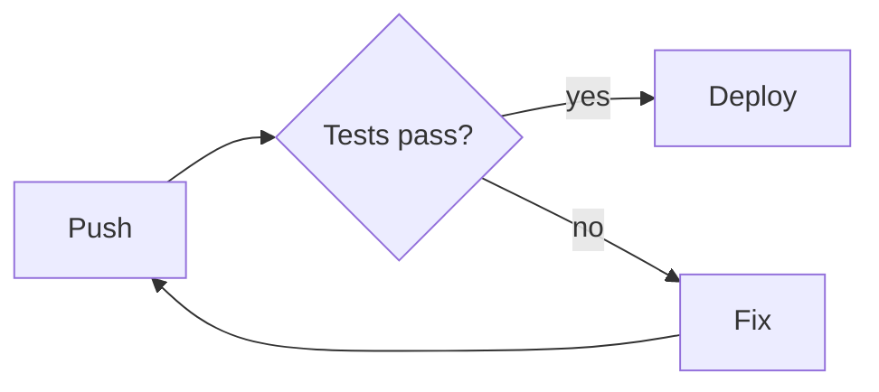

# vt-mermaid

Mermaid diagrams drawn as text for the terminal: a pure Rust library that turns flowchart, sequence, state, class and ER source into a grid of styled cells.

```text
                                     ┌────────┐
                              ┌─yes─▸│ Deploy │
┌──────┐      ╱─────────────╲ │      └────────┘
│ Push ├─────▸│ Tests pass? ├─┤
└──────┘      ╲─────────────╱ │      ┌─────┐
      ▴                       └─no──▸│ Fix │
      │                              └┬────┘
      └───────────────────────────────┘
```

That is vt-mermaid's drawing of this source, checked by the [example](#example) below:



## Why use it

- **It reads Mermaid as mermaid does.**
  The parsers are mermaid 12.3.0's own, rewritten by hand.
  On mermaid's own test corpus, they accept and refuse every input as mermaid does, and read the same nodes, edges and labels.
- **It fits the width you give.**
  A drawing too wide is laid out again, tighter, until it fits, or you get `Error::TooWide` and can fall back.
- **It is safe on untrusted input.**
  No I/O, no clock, no environment; every size has a limit, and a limit hit is a typed error, never a panic.
- **You choose the colours.**
  Each cell carries a `Role` (node, edge, label, group), not an ANSI escape.
- **It is fast.**
  The median diagram of mermaid's corpus is drawn in tens of microseconds.

How it compares with other text renderers of Mermaid, at 80 columns.
The numbers are mean scores out of 100 from [`docs/comparison.md`](https://github.com/vmeyet/vt-mermaid/blob/main/docs/comparison.md), which also gives the rules of this score, our own, and the weak spots.

| Tool | Flowchart | Sequence | State | Class | ER |
|---|--:|--:|--:|--:|--:|
| vt-mermaid 0.1.0 | 95.7 | 97.9 | 98.9 | 97.8 | 99.2 |
| mermaid-text 0.58.0 | 80.9 | 40.8 | 62.3 | 21.2 | 47.7 |
| mermaid-ascii 1.6.2 | 75.1 | 52.3 | 0.0 | 0.0 | 80.5 |
| beautiful-mermaid 1.1.3 | 60.6 | 65.3 | 79.7 | 74.9 | 73.1 |

mermaid-ascii draws no state or class diagram, so it scores 0 there.

## Install

```sh
cargo add vt-mermaid
```

The minimum supported Rust version is 1.92.

## Example

```rust
use vt_mermaid::GlyphSet;

let source = "flowchart LR
  A[Push] --> B{Tests pass?}
  B -->|yes| C[Deploy]
  B -->|no| D[Fix]
  D --> A";
let canvas = vt_mermaid::render(source, 80)?;

let lines: Vec<String> = canvas.lines(GlyphSet::Unicode).map(|line| line.trim_end().to_owned()).collect();
assert_eq!(
    lines,
    [
        "                                     ┌────────┐",
        "                              ┌─yes─▸│ Deploy │",
        "┌──────┐      ╱─────────────╲ │      └────────┘",
        "│ Push ├─────▸│ Tests pass? ├─┤",
        "└──────┘      ╲─────────────╱ │      ┌─────┐",
        "      ▴                       └─no──▸│ Fix │",
        "      │                              └┬────┘",
        "      └───────────────────────────────┘",
    ]
);
# Ok::<(), vt_mermaid::Error>(())
```

- `GlyphSet::Ascii` draws the same in ASCII characters only.
- `Canvas::rows` gives each row as runs of text sharing a `Role`, for you to colour.

## What it draws

| Header | Drawn as |
|---|---|
| `flowchart`, `graph` | Nodes in their shapes, subgraphs as frames, edges routed at right angles with their labels |
| `sequenceDiagram` | Participants side by side, messages, notes, activations and blocks from top to bottom |
| `stateDiagram`, `stateDiagram-v2` | States, start and end dots, choices, forks and joins, composite states as frames, concurrent regions, notes |
| `classDiagram` | Classes as boxes of compartments, relations with their UML heads and cardinalities, namespaces, notes |
| `erDiagram` | Entities as tables of attributes, relationships with crow's feet and roles, subgraphs |

- Any other kind mermaid knows (`pie`, `gantt`, `xychart`…) is `Error::Unsupported`.
- A drawing too wide is laid out again, tighter, its labels wrapped narrower and its ranks folded, until it fits `max_width` or no form does.
- A `graph` or `flowchart` with nothing after its header is an empty canvas, 0 by 0: mermaid accepts it and draws nothing.

## Settings

`render(source, max_width)` draws with the defaults; `render_with(source, settings)` takes `Settings`:

```rust
use vt_mermaid::{LongWords, Settings};

let settings = Settings::new(60).long_words(LongWords::Cut);
let canvas = vt_mermaid::render_with("flowchart TB\n  A[a-word-far-too-long-for-one-line-of-a-node]", settings)?;
# Ok::<(), vt_mermaid::Error>(())
```

| Setting | Means | Default |
|---|---|---|
| `max_width` | The most columns the drawing may take; over vt-canvas's 1000 (`MAX_WIDTH`) it counts as 1000 | Given to `Settings::new` |
| `long_words` | A word wider than a label's line is broken over lines (`LongWords::Break`) or cut with `⋯` (`LongWords::Cut`) | `Break` |

## Roles

| `Role` | Cells |
|---|---|
| `Node` | A node's border, a participant's box or figure |
| `Edge` | A line between nodes, a lifeline or a message, and its tips |
| `Label` | Text: a node's name, an edge's label, a message |
| `Group` | A frame around nodes, a sequence block, a note, and its title |
| `Plain` | Empty cells |

## Errors and limits

Mermaid source is untrusted input: every size is bounded before work starts, and a limit hit is an `Error` you can match, never a panic.

| Error | When |
|---|---|
| `TooLong` | The source is over 64 KiB (`MAX_SOURCE_BYTES`) |
| `Invalid` | Mermaid would refuse the source; `reason` says why |
| `Unsupported` | A kind mermaid knows but not drawn here; `kind` is the source's first word |
| `TooManyNodes`, `TooManyEdges` | A graph over 200 nodes (`MAX_NODES`) or 150 edges (`MAX_EDGES`); the count is where reading stopped |
| `TooManyParticipants`, `TooManyMessages` | A sequence diagram over 50 participants (`MAX_PARTICIPANTS`) or 1000 messages (`MAX_MESSAGES`) |
| `TooLarge` | The routing grid over 250000 cells (`MAX_AREA`) or the canvas over a million (`MAX_CELLS`); `max_cells` says which |
| `TooWide` | No form of the drawing fits `max_width`; `width` is the narrowest found, for a caller that falls back |
| `Unroutable` | An edge finds no path whatever the placement |
| `TooComplex` | Routing the edges took over 6 million steps (`MAX_ROUTING_STEPS`): a bound on the work, the same on every machine |

Mermaid's own corpus is drawn in tens of microseconds at the median and under 30 ms at the slowest.
An input spending the whole routing budget is refused after about half a second on an Apple M5.

## Safety

**Sanitize before printing.**
`Invalid::reason`, `Unroutable::from` and `Unroutable::to` quote the source, and so do the labels on the canvas.
Pass them through your terminal sanitizer, as you would any untrusted text.
`Unsupported::kind` holds at most 32 ASCII letters, digits and `-`.

vt-mermaid itself never prints, reads files or the environment, or looks at the clock.

## Not part of the API

- The `measure` feature adds `measure`, the exact geometry of a drawing for the [scoreboard](https://github.com/vmeyet/vt-mermaid/blob/main/scoreboard/README.md); it is unstable and may change in any release.
- The parsers alone, for fuzzing, are built only with `--cfg fuzzing`.

## Learn more

| Page | What it says |
|---|---|
| [`docs/comparison.md`](https://github.com/vmeyet/vt-mermaid/blob/main/docs/comparison.md) | vt-mermaid and three other text renderers on every diagram of mermaid's corpus: scores, speed, drawings side by side, weak spots |
| [`ARCHITECTURE.md`](https://github.com/vmeyet/vt-mermaid/blob/main/ARCHITECTURE.md) | How the crate is built: its contract, limits and timings, and how each kind is read and laid out |
| [`scoreboard/`](https://github.com/vmeyet/vt-mermaid/blob/main/scoreboard/README.md) | How the comparison is measured |
| [`AGENTS.md`](https://github.com/vmeyet/vt-mermaid/blob/main/AGENTS.md) | How to work on the code |

vt-mermaid draws on [vt-canvas](https://crates.io/crates/vt-canvas), a grid of styled cells with lines, boxes and junctions.

## License

MIT.
The test inputs taken from mermaid are © Knut Sveidqvist and the mermaid contributors, under the MIT license in [`corpus/LICENSE-mermaid`](https://github.com/vmeyet/vt-mermaid/blob/main/corpus/LICENSE-mermaid).
