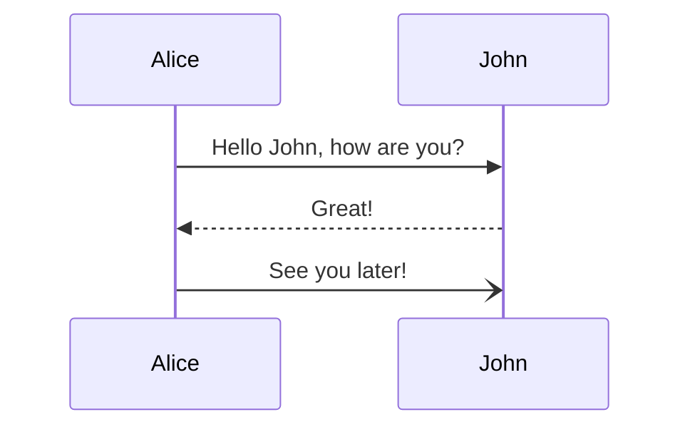
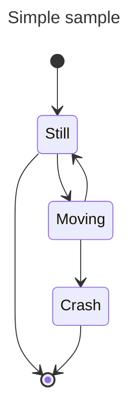
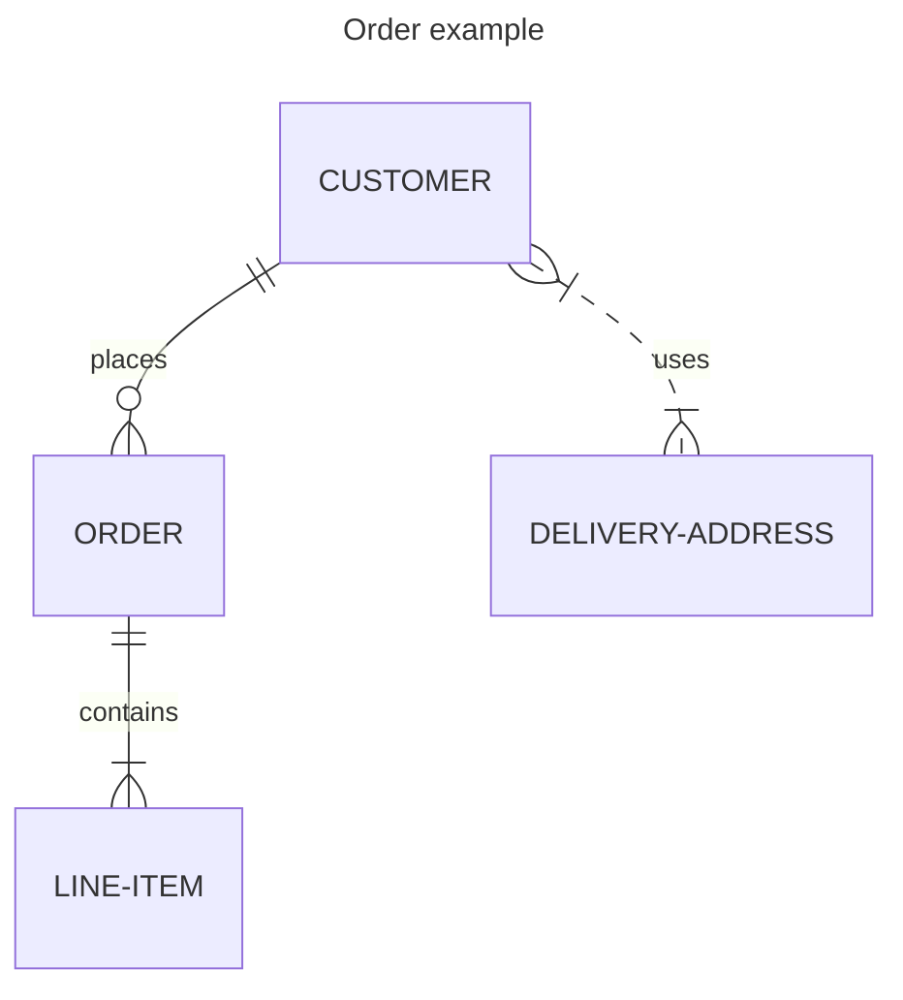
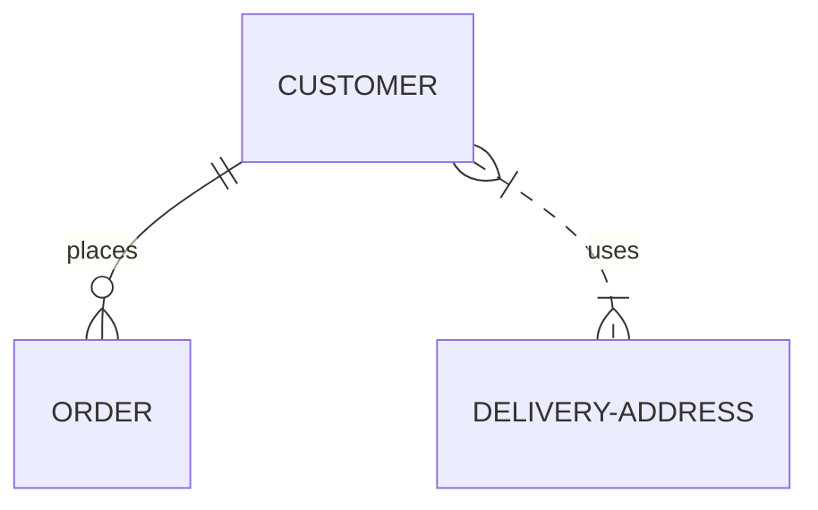
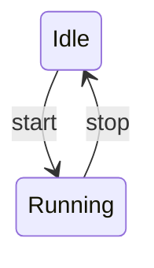
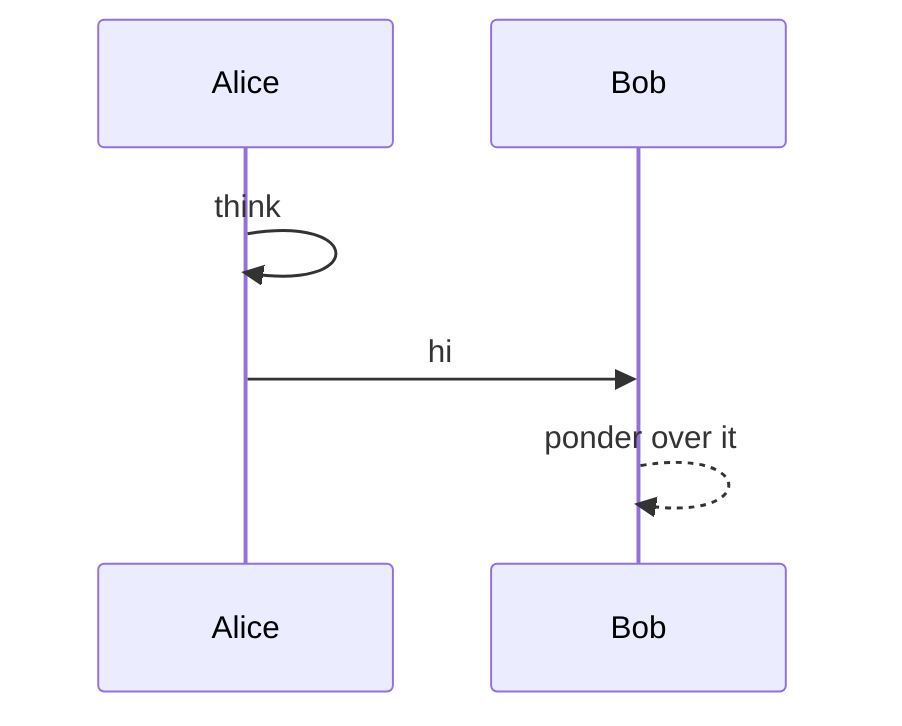

# How vt-mermaid compares

vt-mermaid and three other tools that draw Mermaid as text, run on every flowchart, sequence, state, class and ER diagram in mermaid's own test [corpus](../corpus/README.md).
This page is written by the [scoreboard](../scoreboard/README.md) from one run: do not edit it by hand.
The run was on 2026-11-26, took 4 minutes, on Apple M5 (10 cores) with macOS 27.0.1.

- [At a glance](#at-a-glance)
- [It's our own metric: here are its rules](#its-our-own-metric-here-are-its-rules)
- [Agreement with mermaid](#agreement-with-mermaid)
- [Speed](#speed)
- [Side by side](#side-by-side)
- [Kinds other tools draw that we don't yet](#kinds-other-tools-draw-that-we-dont-yet)
- [Known weak spots](#known-weak-spots)
- [Details per kind](#details-per-kind)
- [Tools and machine](#tools-and-machine)
- [Reproduce](#reproduce)

## At a glance

Mean score out of 100 per diagram kind, higher is better.
The [rules](#its-our-own-metric-here-are-its-rules) say what it counts; a refusal scores 0.

### 80 columns

| Tool | Flowchart | Sequence | State | Class | ER |
|---|--:|--:|--:|--:|--:|
| vt-mermaid 0.1.0 | 95.7 | 97.9 | 98.9 | 97.8 | 99.2 |
| mermaid-text 0.58.0 | 80.9 | 40.8 | 62.3 | 21.2 | 47.7 |
| mermaid-ascii 1.6.2 | 75.1 | 52.3 | 0.0 | 0.0 | 80.5 |
| beautiful-mermaid 1.1.3 | 60.6 | 65.3 | 79.7 | 74.9 | 73.1 |

### 100 columns

| Tool | Flowchart | Sequence | State | Class | ER |
|---|--:|--:|--:|--:|--:|
| vt-mermaid 0.1.0 | 95.7 | 99.4 | 98.9 | 98.3 | 99.2 |
| mermaid-text 0.58.0 | 84.8 | 44.1 | 66.7 | 22.7 | 45.2 |
| mermaid-ascii 1.6.2 | 76.1 | 52.4 | 0.0 | 0.0 | 82.5 |
| beautiful-mermaid 1.1.3 | 60.9 | 66.0 | 80.6 | 75.8 | 73.1 |

## It's our own metric: here are its rules

We wrote this score while building vt-mermaid, so it rewards what we chose to care about.
Read it as a ranking aid, not a verdict.
Every tool's text output is read by the same code ([`metrics.rs`](../scoreboard/metrics.rs), [`lines.rs`](../scoreboard/lines.rs)), at 80 and 100 columns.
What a drawing must show comes from what mermaid.js 12.3.0 itself makes of the input ([oracle](../oracle/README.md)).

Each input scores from 0 to 100, rounded to a whole number:

| Part | Points | Read from the text |
|---|---|---|
| Labels | 50 × the share found | Node and edge labels together. A label is found when every word of it appears somewhere in the drawing, markup removed. Full points when mermaid expects no label. |
| Fits | 20 or 0 | The widest row is at most the columns asked for. |
| Arrowheads | 15 × (1 − min(\|drawn − expected\|, e) ÷ e), with e = max(expected, 1) | Arrowhead glyphs, plus one per edge merged into a shared head. Class diagrams count triangles and diamonds too. ER diagrams count none, so every ER drawing gets these 15 points. |
| Crossings | 15 ÷ (1 + crossings) | `┼`-like glyphs, without those where merged edges part or gather. In ER diagrams only a `┼` joined on all four sides, as crow's feet use `┼` as a bar. |

- A refusal, a crash or a timeout scores 0.
- The mean is over the inputs where mermaid's meaning has at least one node: 905 of 946 flowcharts, 386 of 394 sequence diagrams, 268 of 279 state diagrams, 313 of 372 class diagrams, 310 of 315 ER diagrams.
- It does not judge how easy a drawing is to follow, nor its size: the per-kind summaries count rows, area and bends on the inputs every tool drew.
- Words can match elsewhere in the drawing, and a label cut short with `⋯` counts as missing.
- Glyph counts are proxies; vt-mermaid's exact geometry, in the same summaries, shows how far off they are.
- The other tools get the source without its front matter (`---` … `---`), which they refuse.
- The full rules are in the [scoreboard's metrics](../scoreboard/README.md#metrics).

## Agreement with mermaid

vt-mermaid's parsers are mermaid 12.3.0's, rewritten by hand.
Two levels are checked against mermaid.js on the corpus:

- Level A, the verdict: `render` refuses a source as `Invalid` exactly when mermaid refuses it.
  Measured by this run through `render`, at 100 columns.
  An input over a size or count limit (`TooLong`, `TooManyNodes`…) stops being read before its verdict is known, so it is not judged.
- Level B, the meaning: on every input both accept, the same nodes, edges, labels and groups.
  Checked by the crate's tests (`src/<kind>/parse/agreement.rs`), which fail on any difference, not by this run.

| Kind | Inputs | mermaid accepts | Read whole | Level A: same verdict | Level B: inputs compared |
|---|--:|--:|--:|--:|--:|
| Flowchart | 946 | 925 | 933 | 933 of 933 | 925 |
| Sequence | 394 | 386 | 394 | 394 of 394 | 386 |
| State | 279 | 276 | 279 | 279 of 279 | 276 |
| Class | 372 | 315 | 372 | 372 of 372 | 315 |
| ER | 315 | 312 | 315 | 315 of 315 | 312 |

## Speed

### The library alone

`render` timed in-process at 100 columns, one input at a time, with nothing else running.
An input under 50 ms is timed 5 times and the fastest run kept.
The last column is what `render` returned; the [README](../README.md#errors-and-limits) explains each error.
`empty` is a diagram mermaid accepts but finds nothing to draw in, such as a header alone; the scoreboard counts it as refused.

| Kind | Inputs | Median | p95 | Slowest | Returned |
|---|--:|--:|--:|--:|--:|
| Flowchart | 946 | 23 µs | 1.0 ms | 25.1 ms | drawn 898, Invalid 20, empty 15, TooLong 8, TooManyNodes 3, TooManyEdges 2 |
| Sequence | 394 | 13 µs | 225 µs | 511 µs | drawn 386, Invalid 8 |
| State | 279 | 35 µs | 241 µs | 4.0 ms | drawn 269, empty 7, Invalid 3 |
| Class | 372 | 14 µs | 207 µs | 10.0 ms | drawn 313, Invalid 57, empty 2 |
| ER | 315 | 27 µs | 211 µs | 1.6 ms | drawn 312, Invalid 3 |

### Every tool, start-up included

Wall time of one child process per input at 80 columns, as median / p95 / slowest in milliseconds.
The runs share all cores, and start-up counts: Node starts again for every input of beautiful-mermaid.
Only the order of magnitude means something here.

| Tool | Flowchart | Sequence | State | Class | ER |
|---|--:|--:|--:|--:|--:|
| vt-mermaid | 9 / 15 / 148 | 9 / 15 / 258 | 9 / 15 / 37 | 9 / 16 / 164 | 9 / 13 / 18 |
| mermaid-text | 9 / 17 / 10260 | 9 / 15 / 204 | 9 / 16 / 33 | 8 / 14 / 160 | 8 / 12 / 15 |
| mermaid-ascii | 19 / 51 / 10270 | 18 / 32 / 105 | 18 / 31 / 69 | 18 / 31 / 100 | 18 / 28 / 54 |
| beautiful-mermaid | 177 / 269 / 10491 | 173 / 258 / 455 | 185 / 297 / 500 | 176 / 238 / 368 | 168 / 224 / 283 |

## Side by side

The opening example of three syntax pages in mermaid's docs, at 80 columns.
Each is drawn by vt-mermaid, then by the other tool with the best mean score on that kind.
They are picked by that rule, not by how they look.
On GitHub, the first block is mermaid's own drawing.

### `sequence/docs--syntax-sequenceDiagram--L12.mmd`



**vt-mermaid 0.1.0**

```text
┌───────┐                   ┌──────┐
│ Alice │                   │ John │
└───┬───┘                   └──┬───┘
    │                          │
    │ Hello John, how are you? │
    │─────────────────────────▸│
    │                          │
    │          Great!          │
    │◂╌╌╌╌╌╌╌╌╌╌╌╌╌╌╌╌╌╌╌╌╌╌╌╌╌│
    │                          │
    │      See you later!      │
    │─────────────────────────▸│
    │                          │
┌───┴───┐                   ┌──┴───┐
│ Alice │                   │ John │
└───────┘                   └──────┘
```

**beautiful-mermaid 1.1.3**

```text
 ┌───────┐                     ┌──────┐
 │ Alice │                     │ John │
 └───┬───┘                     └───┬──┘
     │                             │
     │  Hello John, how are you?   │
     │─────────────────────────────▶
     │                             │
     │           Great!            │
     ◀╌╌╌╌╌╌╌╌╌╌╌╌╌╌╌╌╌╌╌╌╌╌╌╌╌╌╌╌╌│
     │                             │
     │       See you later!        │
     │─────────────────────────────▷
     │                             │
 ┌───┴───┐                     ┌───┴──┐
 │ Alice │                     │ John │
 └───────┘                     └──────┘
```


### `state/docs--syntax-stateDiagram--L15.mmd`



**vt-mermaid 0.1.0**

```text
      ⬤
      │
      │
      ▾
  ┌───────┐
  │ Still │
  └─┬─┬───┘
    │ │ ▴
┌───┘ │ │
│     ▾ │
│ ┌─────┴──┐
│ │ Moving │
│ └───┬────┘
│     │
│     │
│     ▾
│ ┌───────┐
│ │ Crash │
│ └───┬───┘
│     │
└─────┤
      ▾
      ◉
```

**beautiful-mermaid 1.1.3**

```text
●───────●
│       │
●───┬───●
    │
    │
    ├──────┐
    │      │
    ▼      │
╭───────╮  │
│       │  │
│ Still │  │
│       │  │
╰───────╯  │
    │      │
    │      │
    ├──────┼───────┐
    │      │       │
    ▼      │       ▼
╔═══════╗  │  ╭────────╮
║       ║  │  │        │
║       ║  │  │ Moving │
║       ║  │  │        │
╚═══════╝  │  ╰────┬───╯
           │       │
           │       │
           └───────┤
                   │
                   │
╭───────╮          │
│       │          │
│ Crash │◄─────────┘
│       │
╰───┬───╯
    │
    │
    │
    │
    ▼
╔═══════╗
║       ║
╚═══════╝
```


### `er/docs--syntax-entityRelationshipDiagram--L14.mmd`



**vt-mermaid 0.1.0**

```text
          ┌──────────┐
          │ CUSTOMER │
          └──────────┘
              ┼ V
              ┼ ┼
      ┌───────┘ ╎
      │       uses
   places       ╎
      o         ┼
      Ʌ         Ʌ
  ┌───────┐    ┌──────────────────┐
  │ ORDER │    │ DELIVERY-ADDRESS │
  └───────┘    └──────────────────┘
      ┼
      ┼
      │
  contains
      │
      ┼
      Ʌ
┌───────────┐
│ LINE-ITEM │
└───────────┘
```

**mermaid-ascii 1.6.2**

```text
┌──────────┐                 ┌───────┐
│ CUSTOMER │                 │ ORDER │
└───┬───┬──┘                 └──┬───┬┘
    └||─┼──────places─────────o{┘   │
       ┌}|────────contains────────||┘
       │└}|┈┈┈┈┈┈┈┈┈┈┈uses┈┈┈┈┈┈┈┈┈┈┈|{┐
┌──────┴────┐                ┌─────────┴────────┐
│ LINE-ITEM │                │ DELIVERY-ADDRESS │
└───────────┘                └──────────────────┘
```


## Kinds other tools draw that we don't yet

vt-mermaid draws five kinds; for every other kind mermaid knows, `render` returns `Unsupported`.
Every corpus input of those kinds was run through each tool at 80 columns.
Drawn means the tool exited without error and printed something: the drawing was not checked against mermaid's meaning.

| Kind | Inputs | vt-mermaid | mermaid-text | mermaid-ascii | beautiful-mermaid |
|---|--:|--:|--:|--:|--:|
| architecture | 58 | 0 | 23 | 0 | 0 |
| block | 121 | 0 | 117 | 0 | 0 |
| gantt | 75 | 0 | 25 | 0 | 0 |
| git | 258 | 0 | 141 | 0 | 0 |
| journey | 24 | 0 | 13 | 0 | 0 |
| mindmap | 89 | 0 | 81 | 0 | 0 |
| packet | 26 | 0 | 25 | 0 | 0 |
| pie | 66 | 0 | 40 | 0 | 0 |
| quadrant | 49 | 0 | 49 | 0 | 0 |
| requirement | 186 | 0 | 147 | 0 | 0 |
| sankey | 30 | 0 | 30 | 0 | 0 |
| timeline | 55 | 0 | 49 | 0 | 0 |
| xychart | 118 | 0 | 27 | 0 | 68 |

No tool drew any input of: agentflow, c4, cynefin, eventmodeling, info, ishikawa, kanban, radar, railroad, swimlane, tree-view, treemap, unknown, usecase, venn, wardley, zenuml.

Among the five kinds on the board, mermaid-ascii draws no state diagram and no class diagram.

## Known weak spots

Drawn by vt-mermaid at 80 columns on this run, so a fix shows here.

### ER crow's feet are cramped

Each end of a relationship takes two rows of marks, and two relationships leaving one entity put their marks side by side.
A label can sit across its own line.



```text
        ┌──────────┐
        │ CUSTOMER │
        └──────────┘
            ┼ V
            ┼ ┼
    ┌───────┘ ╎
    │       uses
 places       ╎
    o         ┼
    Ʌ         Ʌ
┌───────┐    ┌──────────────────┐
│ ORDER │    │ DELIVERY-ADDRESS │
└───────┘    └──────────────────┘
```

### Labels on a cycle of two states

When two states point at each other, both lines and both labels share the narrow gap between them.
A label can cover one of the lines.



```text
┌──────┐
│ Idle │
└──┬───┘
   │  ▴
start │
   ▾ stop
 ┌────┴────┐
 │ Running │
 └─────────┘
```

### Messages to oneself are small

A message from a participant to itself is a loop two columns wide under its label, easy to miss in a busy diagram.



```text
┌───────┐   ┌─────┐
│ Alice │   │ Bob │
└───┬───┘   └──┬──┘
    │          │
    │ think    │
    │──┐       │
    │◂─┘       │
    │          │
    │    hi    │
    │─────────▸│
    │          │
    │          │ ponder over it
    │          │╌╌┐
    │          │◂╌┘
    │          │
┌───┴───┐   ┌──┴──┐
│ Alice │   │ Bob │
└───────┘   └─────┘
```

## Details per kind

At 80 columns; the [scoreboard's metrics](../scoreboard/README.md#metrics) define every column.
Median and p95 are wall times as above.
Each kind's summary adds 100 columns, layout counts on the inputs every tool drew, and vt-mermaid's exact geometry.

### Flowchart

946 inputs, 925 with a meaning from mermaid; [full summary](../scoreboard/results/summary.md).

| Tool | Rendered | Refused | Crashed | Timed out | Fits | Node labels | Edge labels | Arrows right | Score | Median ms | p95 ms |
|---|--:|--:|--:|--:|--:|--:|--:|--:|--:|--:|--:|
| vt-mermaid 0.1.0 | 898 | 48 | 0 | 0 | 898 | 97.2% | 94.6% | 93.4% | 95.7 | 9 | 15 |
| mermaid-text 0.58.0 | 777 | 158 | 0 | 11 | 771 | 81.6% | 80.7% | 78.4% | 80.9 | 9 | 17 |
| mermaid-ascii 1.6.2 | 751 | 143 | 45 | 7 | 595 | 79.1% | 78.5% | 74.2% | 75.1 | 19 | 51 |
| beautiful-mermaid 1.1.3 | 714 | 216 | 3 | 13 | 655 | 55.8% | 62.0% | 47.2% | 60.6 | 177 | 269 |

### Sequence

394 inputs, 386 with a meaning from mermaid; [full summary](../scoreboard/results/sequence/summary.md).

| Tool | Rendered | Refused | Crashed | Timed out | Fits | Node labels | Edge labels | Arrows right | Score | Median ms | p95 ms |
|---|--:|--:|--:|--:|--:|--:|--:|--:|--:|--:|--:|
| vt-mermaid 0.1.0 | 384 | 10 | 0 | 0 | 384 | 95.7% | 96.5% | 99.5% | 97.9 | 9 | 15 |
| mermaid-text 0.58.0 | 164 | 230 | 0 | 0 | 164 | 41.2% | 40.9% | 38.9% | 40.8 | 9 | 15 |
| mermaid-ascii 1.6.2 | 211 | 183 | 0 | 0 | 179 | 54.4% | 55.8% | 46.9% | 52.3 | 18 | 32 |
| beautiful-mermaid 1.1.3 | 301 | 93 | 0 | 0 | 230 | 69.1% | 68.3% | 44.0% | 65.3 | 173 | 258 |

### State

279 inputs, 276 with a meaning from mermaid; [full summary](../scoreboard/results/state/summary.md).

| Tool | Rendered | Refused | Crashed | Timed out | Fits | Node labels | Edge labels | Arrows right | Score | Median ms | p95 ms |
|---|--:|--:|--:|--:|--:|--:|--:|--:|--:|--:|--:|
| vt-mermaid 0.1.0 | 269 | 10 | 0 | 0 | 269 | 100.0% | 91.2% | 95.7% | 98.9 | 9 | 15 |
| mermaid-text 0.58.0 | 177 | 102 | 0 | 0 | 177 | 63.5% | 46.4% | 56.5% | 62.3 | 9 | 16 |
| mermaid-ascii 1.6.2 | 0 | 279 | 0 | 0 | 0 | 0.0% | 0.0% | 0.0% | 0.0 | 18 | 31 |
| beautiful-mermaid 1.1.3 | 247 | 32 | 0 | 0 | 217 | 81.4% | 78.2% | 51.8% | 79.7 | 185 | 297 |

### Class

372 inputs, 315 with a meaning from mermaid; [full summary](../scoreboard/results/class/summary.md).

| Tool | Rendered | Refused | Crashed | Timed out | Fits | Node labels | Edge labels | Arrows right | Score | Median ms | p95 ms |
|---|--:|--:|--:|--:|--:|--:|--:|--:|--:|--:|--:|
| vt-mermaid 0.1.0 | 313 | 59 | 0 | 0 | 313 | 98.5% | 98.6% | 93.7% | 97.8 | 9 | 16 |
| mermaid-text 0.58.0 | 69 | 303 | 0 | 0 | 69 | 21.7% | 2.8% | 21.6% | 21.2 | 8 | 14 |
| mermaid-ascii 1.6.2 | 0 | 372 | 0 | 0 | 0 | 0.0% | 0.0% | 0.0% | 0.0 | 18 | 31 |
| beautiful-mermaid 1.1.3 | 325 | 47 | 0 | 0 | 255 | 73.2% | 43.9% | 70.5% | 74.9 | 176 | 238 |

### ER

315 inputs, 312 with a meaning from mermaid; [full summary](../scoreboard/results/er/summary.md).

| Tool | Rendered | Refused | Crashed | Timed out | Fits | Node labels | Edge labels | Arrows right | Score | Median ms | p95 ms |
|---|--:|--:|--:|--:|--:|--:|--:|--:|--:|--:|--:|
| vt-mermaid 0.1.0 | 312 | 3 | 0 | 0 | 312 | 99.4% | 99.6% | 100.0% | 99.2 | 9 | 13 |
| mermaid-text 0.58.0 | 155 | 160 | 0 | 0 | 155 | 45.5% | 49.8% | 49.7% | 47.7 | 8 | 12 |
| mermaid-ascii 1.6.2 | 268 | 47 | 0 | 0 | 220 | 85.8% | 86.9% | 85.3% | 80.5 | 18 | 28 |
| beautiful-mermaid 1.1.3 | 249 | 66 | 0 | 0 | 249 | 69.9% | 60.4% | 79.8% | 73.1 | 168 | 224 |

## Tools and machine

| Tool | Version | Runs as |
|---|---|---|
| [vt-mermaid](https://github.com/vmeyet/vt-mermaid) | 0.1.0 | Rust, in-process in a child of the runner |
| [mermaid-text](https://crates.io/crates/mermaid-text) | 0.58.0 | Rust, in-process in a child of the runner |
| [mermaid-ascii](https://github.com/AlexanderGrooff/mermaid-ascii) | 1.6.2 | Go, its release binary with `--max-width` |
| [beautiful-mermaid](https://github.com/lukilabs/beautiful-mermaid) | 1.1.3 | TypeScript, `renderMermaidASCII` in Node |

- Date: 2026-11-26
- CPU: Apple M5, 10 cores
- OS: macOS 27.0.1
- Rust: rustc 1.99.0 (b940084d7 2026-09-28)
- Node: v24.15.0
- Corpus and oracle: mermaid 12.3.0
- Deadline: 10 seconds per input; a tool still running is killed and counts as timed out.

## Reproduce

```sh
scoreboard/install.sh
cargo run --release --example scoreboard -- --markdown docs/comparison.md
```

- Needs Rust (the toolchain in `rust-toolchain.toml`), `curl` and `shasum` for mermaid-ascii, and Node.js with npm for beautiful-mermaid.
- `install.sh` is the only step that uses the network.
  It installs the pinned versions outside the repository, in `~/.cache/vt-scoreboard`, and checks mermaid-ascii's sha256.
- A tool that is not installed is skipped and keeps its last committed results.
- The run also rewrites `scoreboard/results/`, and took 4 minutes here.
- Scores do not change between runs on the same code, except for a few flowcharts that mermaid-text 0.58.0 draws differently each time; times and the machine do.
